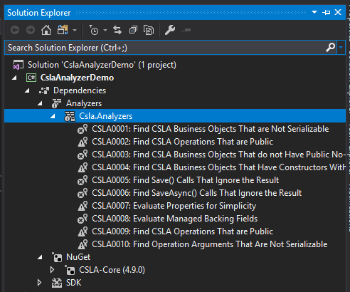
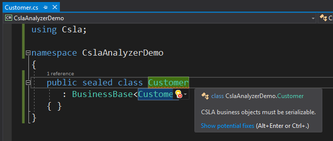
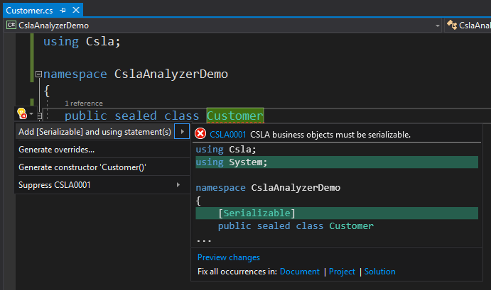
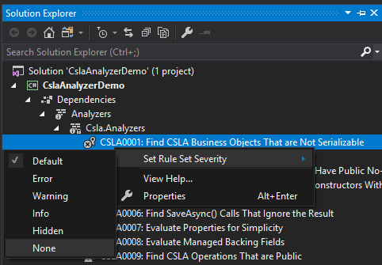

# Introduction
With the 4.6 release of CSLA, a set of analyzers have been added to encourage and enforce patterns and idioms when using the CSLA framework. Let's go through the details on the analyzers.
## The Basics
When you add CSLA to your project via NuGet, the analyzers will automatically be installed:

If you're building a project using csc.exe directly, you'll have to use the [`-analyzer` option](https://docs.microsoft.com/en-us/dotnet/csharp/language-reference/compiler-options/listed-alphabetically).

If you violate one of the rules, like making a business object that isn't serializable, you'll get an error or a warning:

Some of the analyzers have code fixes, which will automatically fix the issue for you:

## Unexpected Errors
While we try to make the analyzers as stable as we can, we may run into coding patterns that we didn't anticipate, which will cause the analyzers to fail. You can disable analyzers if they're causing too many issues for you by setting the severity to `None` (though we don't recommend you do this unless the analyzers are crashing):

Unfortunately, Visual Studio doesn't make it easy to get crash information on an analyzer. The best you can do is launch `devenv.exe` with the `/log` switch, and see if the log file contains any meaningful information. Also, please log an issue on the [CSLA site]((https://github.com/MarimerLLC/csla/issues)) if you do find problems with an analyzer, and we'll do our best to resolve the problem.
## Analyzer Proposals
If you have an idea for an analyzer that would be beneficial for developers using CSLA, please propose it in the [forums](https://github.com/MarimerLLC/cslaforum/issues), and tag it with "feature discussion".
## Analyzer Reference
* [CSLA0001](CSLA0001-IsBusinessObjectSerializableAnalyzer.md) - CSLA business objects must be serializable
* [CSLA0002](CSLA0002-IsOperationMethodPublicAnalyzer.md) - CSLA operations should not be public
* [CSLA0003](CSLA0003-CheckConstructorsAnalyzer.md) - CSLA business objects must have a public constructor with no arguments
* [CSLA0004](CSLA0004-CheckConstructorsAnalyzer.md) - CSLA business objects should not have public constructors with parameters
* [CSLA0005](CSLA0005-FindSaveAssignmentIssueAnalyzer.md) - Do not ignore the result of `Save()`
* [CSLA0006](CSLA0006-FindSaveAssignmentIssueAnalyzer.md) - Do not ignore the result of `SaveAsync()`
* [CSLA0007](CSLA0007-EvaluatePropertiesForSimplicityAnalyzer.md) - Properties that use managed backing fields should only use Get/Set/Read/Load methods
* [CSLA0008](CSLA0008-EvaluateManagedBackingFieldsAnalayzer.md) - Managed backing fields must be public, static and read-only
* [CSLA0009](CSLA0009-IsOperationMethodPublicAnalyzer.md) - CSLA operations should not be public on an interface
* [CSLA0010](CSLA0010-FindOperationsWithNonSerializableArgumentsAnalyzer.md) - Operation argument types should be serializable
* [CSLA0011](CSLA0011-FindBusinessObjectCreationAnalyzer.md) - CSLA business objects should not be created outside of an `ObjectFactory` instance
* [CSLA0012](CSLA0012-FindOperationsWithIncorrectReturnTypesAnalyzer.md) - The return type from an operation should be either `void` or `Task`
* [CSLA0013](CSLA0013-DoesChildOperationHaveRunLocalAnalyzer.md) - Child operations should not have `[RunLocal]`
* [CSLA0014](CSLA0014-DoesOperationHaveAttributeAnalyzer.md) - Operations should have the appropriate operation attribute
* [CSLA0015](CSLA0015-EvaluateOperationAttributeUsageAnalyzer.md) - Operation attributes should be used correctly
* [CSLA0016](CSLA0016-AsynchronousBusinessRuleInheritingFromBusinessRuleAnalyzer.md) - Asynchronous business rules should derive from `BusinessRuleAsync`
* [CSLA0017](CSLA0017-BusinessRuleDoesNotUseAddMethodsOnContextAnalyzer.md) - Business rules should use at least one `Add()` method on the context
* [CSLA0018](CSLA0018-IsCompleteCalledInAsynchronousBusinessRuleAnalyzer.md) - `Complete()` should not be called in an asynchronous business rule
* [CSLA0019](CSLA0019-FindRefAndOutParametersInOperationsAnalyzer.md) - Operations should not have `ref` or `out` parameters
* [CSLA0020](CSLA0020-ObjectAuthorizationRulesAttributeMissing.md) - Object authorization rules configuration should be marked with attribute
* [CSLA0021](CSLA0021-ObjectAuthorizationRulesPublic.md) - Object authorization rules configuration should be declared as public
* [CSLA0022](CSLA0022-ObjectAuthorizationRulesStatic.md) - Object authorization rules configuration should be declared as static
* [CSLA0024](CSLA0024-TypeWithOperationsShouldBePartialAnalyzer.md) - Types with data portal operation methods should be partial
* [CSLA0025](CSLA0025-UseGeneratedDataPortalExtensionAnalyzer.md) - Use the generated data portal extension method
* [CSLA0026](CSLA0026-CalculatedPropertyAnalyzer.md) - Calculated properties should be read-only
* [CSLA0027](CSLA0027-CalculatedPropertyAnalyzer.md) - Calculated properties are only supported in `BusinessBase` types
* [CSLA0028](CSLA0028-MobileSerializerAttributeUsageAnalyzer.md) - Custom serializer declaration is not valid
* [CSLA0029](CSLA0029-MobileSerializerAttributeUsageAnalyzer.md) - Type has more than one custom serializer

## Suppressors
Some .NET code style and code quality rules report false positives on CSLA code, because CSLA calls data portal operations and other methods through reflection. The `Csla` package includes diagnostic suppressors that hide these diagnostics only where they don't apply. The diagnostics still appear everywhere else.

| Suppression ID | Suppresses | Where |
|---|---|---|
| `CSLA1001` | `IDE0051` (remove unused private member) | Data portal operations the data portal calls, and the object authorization rules method CSLA calls: a public static method with `[ObjectAuthorizationRules]`, or, when a type has none, a static method named `AddObjectAuthorizationRules` |
| `CSLA1002` | `CA1822` (mark members as static) | Data portal operations the data portal calls. The data portal only calls instance methods, so making an operation static breaks it at runtime |
| `CSLA1003` | `IDE0060` (remove unused parameter) | Criteria parameters of data portal operations the data portal calls. The data portal chooses an operation by these parameter types, so removing one changes which method is called. `[Inject]` parameters, parameters of lambdas and local functions inside an operation, and the context parameter of an object authorization rules method are not suppressed, because removing them is safe |
| `CSLA1004` | `IDE0058` (expression value is never used) | Calls to CSLA fluent configuration methods, such as `services.AddCsla(...)`, `options.DataPortal(...)` or `proxy.WithDataPortalUrl(...)`. These are methods in a CSLA assembly (signed with the CSLA key) that return the type they were called on: extension methods, and instance methods of the CSLA builder types (types named `*Options` or `*Tester`, such as `CslaOptions` or `BusinessRuleTester`). Other methods that return their own type, such as `Clone()`, create a new object, so they don't qualify, and neither do static factory methods or `Save()`/`SaveAsync()`. Ignoring the result of `Save()` is a bug (see CSLA0005 and CSLA0006) |

A data portal operation is a non-generic instance method with `[Create]`, `[Fetch]`, `[FetchChild]` or another operation attribute (or an attribute derived from one), in a type that implements `ICslaObject`. The data portal calls it through the mapping the bundled source generator emits for `partial` types, or else through reflection, which only finds non-public methods. The suppressors leave the diagnostics in place where the data portal never calls the method, so they still point out dead code:

* methods without an operation attribute, including legacy names such as `DataPortal_Fetch`
* operation attributes outside a CSLA type, and on static or generic methods
* methods with only a base attribute such as `[DataPortalChildOperation]`, which the data portal never looks for
* public operations in a type that isn't `partial`
* root operations in a type with `[ObjectFactory]` or an attribute derived from it (the factory handles those)
* child operations in such a type, unless the generated mapping calls them (the type is `partial` and the method has a CSLA operation attribute itself, not a derived one) or the operation is `[CreateChild]`
* an `AddObjectAuthorizationRules` method that CSLA can't call: private in an abstract type, overloaded, or with parameters other than the rules context

To turn a suppressor off, add its ID to `NoWarn` in your project file, for example `<NoWarn>$(NoWarn);CSLA1002</NoWarn>`. Setting `dotnet_diagnostic.CSLA1002.severity` in an `.editorconfig` file doesn't affect suppressors.

## Data Portal Generator Diagnostics
These diagnostics come from the data portal operations and data portal extensions source generators included in the `Csla` package. They report operation methods that the generated code handles differently from what you might expect, and data portal extension methods that are not generated. They are reported by analyzers, so you can suppress them in source or in an `.editorconfig` file.

* [CSLADP002](CSLADP002-DuplicateOperationName.md) - Data portal operation methods share an operation name
* [CSLADP003](CSLADP003-GenericExtensionsNotGenerated.md) - Data portal extensions are not generated for generic types
* [CSLADP004](CSLADP004-InvalidExtensionsTarget.md) - Invalid target for `[DataPortalExtensions]`
* [CSLADP005](CSLADP005-ExtensionNameHidden.md) - Generated data portal extension would be hidden
* [CSLADP006](CSLADP006-InaccessibleParameterType.md) - Operation parameter type is not accessible
* [CSLADP007](CSLADP007-DuplicateExtensionMethod.md) - Generated data portal extension would be duplicated
* [CSLADP008](CSLADP008-InvalidExtensionPrefix.md) - Invalid `[DataPortalExtensions]` prefix
* [CSLADP009](CSLADP009-AmbiguousOperationName.md) - Data portal operation methods are ambiguous
* [CSLADP010](CSLADP010-InvalidAsyncSuffix.md) - Invalid data portal extensions async suffix
* [CSLADP011](CSLADP011-SyncExtensionsNotGenerated.md) - Synchronous data portal extensions are not generated without an async suffix
